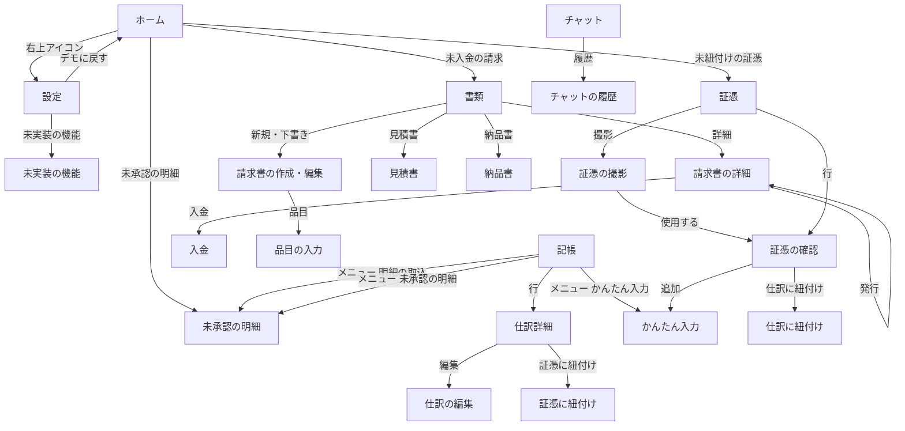

# ナビゲーション

アプリ内の画面遷移と下部タブの構造である。

## 下部タブ

左から **ホーム、記帳、書類、証憑、チャット** の 5 つとする。

設定は下部タブに置かない。ホーム右上のアイコンだけから開く。文言は付けない。

未実装の機能はタブに出さない。

## チャットの入口

入口は下部タブのチャットとする。
どの画面のフッターからでも、チャットの画面を開く。シートにはしない。

## 押し込む画面

押し込む画面のナビは iOS に合わせ、左に戻る、中央にタイトル、右に操作を置く。

## 画面遷移

タブ間の切替は図に書いていない。どのタブからでもチャットへ進める。

## 参照

- [画面の共通](common-ui.md)
- [チャット](chat.md)
- [画面一覧](../screens/)
